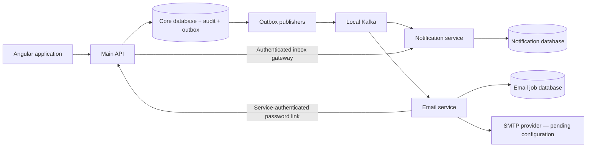

# Local services and event delivery

The main API owns projects, tickets, membership, comments, attachments, account credentials, and the immutable activity history. Two independently deployable projects live directly under `/Users/giridharsundeep/Documents/projects`:

| Project | Local port | Owned database | Responsibility |
|---|---:|---|---|
| `professy-backend/professy` | 8080 | `professy` | Business APIs, authentication, authorization, transactional event outbox |
| `professy-notification-service` | 8082 | `professy_notification` | Kafka event consumption, inbox storage, unread/read state |
| `professy-email-service` | 8083 | `professy_email` | Durable mail jobs, SMTP delivery and retries |



## Current installed state

Kafka 4.4.0 is installed from the checksum-verified Homebrew bottle. Homebrew's package installation failed on this macOS version, so the package is managed as a user LaunchAgent, not a Homebrew service.

- Broker: `127.0.0.1:9092`; KRaft controller: `127.0.0.1:9093`.
- Service: `com.greatleyposhley.kafka`, starts at login and restarts after failure.
- Installation/config/data/logs: `~/.local/share/professy/kafka/`.
- LaunchAgent: `~/Library/LaunchAgents/com.greatleyposhley.kafka.plist`.
- CLI wrappers: `/opt/homebrew/bin/kafka-*`.
- Java: the installed OpenJDK 26.0.2; heap 256–768 MB.
- Topics: `professy.ticket-events.v1`, `professy.ticket-events.v1.dlt`, `professy.account-mail.v1`, `professy.account-mail.v1.dlt`; three partitions each.
- Producer/consumer verification passed in a temporary topic, which was removed.
- The notification and email services were built and then started by the user on ports 8082 and 8083. SMTP delivery remains disabled.

```sh
# Status
launchctl print gui/$(id -u)/com.greatleyposhley.kafka
kafka-topics --bootstrap-server 127.0.0.1:9092 --list
# Restart the existing broker, retaining its data
launchctl kickstart -k gui/$(id -u)/com.greatleyposhley.kafka
# Stop automatic restarts until loaded again
launchctl bootout gui/$(id -u) "$HOME/Library/LaunchAgents/com.greatleyposhley.kafka.plist"
# Start again
launchctl bootstrap gui/$(id -u) "$HOME/Library/LaunchAgents/com.greatleyposhley.kafka.plist"
```

Do not format the existing Kafka data directory again.

## Build and run

Each service has its own Gradle wrapper, dependencies, executable JAR, database schema, and configuration. No frontend calls service ports directly; the core API forwards authenticated inbox requests.

```sh
cd /Users/giridharsundeep/Documents/projects/professy-notification-service
./gradlew bootJar
java -jar build/libs/professy-notification-service-1.0.0.jar
```

```sh
cd /Users/giridharsundeep/Documents/projects/professy-email-service
./gradlew bootJar
java -jar build/libs/professy-email-service-1.0.0.jar
```

Start/restart the existing main API through its normal development workflow after these changes. Health and readiness endpoints on each delivery service are `/actuator/health` and `/actuator/health/readiness`; metrics are available locally at `/actuator/prometheus`.

Private generated local credentials are in `~/.config/professy/notification.properties`, `~/.config/professy/email.properties`, and `~/.config/professy/core.properties` (also copied to the core API's ignored `.runtime/services.properties` for compatibility). They have owner-only access and are not committed. Service database users have privileges only on their own schema. Neither delivery service accesses the core database.

For another environment supply `DB_URL`, `DB_USERNAME`, `DB_PASSWORD`, `CORE_API_URL`, `PROFESSY_SERVICE_TOKEN`, `KAFKA_BOOTSTRAP_SERVERS`, and optional `PORT`, `BIND_ADDRESS`, `DB_POOL_SIZE`. Use the same private service token for the core and delivery services. Local files are only a development convenience; use a deployment secret store for production.

## Delivery guarantees and operations

JPA lifecycle listeners and application services record ticket changes and a transactional outbox event. The request filter supplies the authenticated actor and flushes JPA before clearing that context. SQL changes outside authenticated requests appear as System activity. Inserts, meaningful field updates, deletes, tag changes, comments, and attachments are recorded in Java.

The publisher locks pending rows with `FOR UPDATE SKIP LOCKED`, waits for Kafka acknowledgements, marks published only afterwards, and retries with backoff. A crash after publishing can produce a duplicate. Notification inserts have a unique `(event_id,user_id)` key; mail ingestion has an `event_id` primary key. Consumers commit offsets only after handling succeeds. Repeatedly failing Kafka messages go to the corresponding `.dlt` topic after bounded retries. Alert on nonempty DLT topics and old unpublished outbox rows. Resolve the cause before deliberately replaying selected DLT records to their source topic with the same event ID.

Ticket event version 1 contains `eventVersion`, `eventId`, `occurredAt`, `orgId`, `projectId`, `ticketType`, `ticketId`, `title`, `body`, and `recipients`. It contains no password link, credential, attachment content, or full description. Consumers reject unsupported versions. Legacy ID-only events can be resolved through the service-authenticated internal contract.

Email events contain only `eventId`. A separate durable mail job is inserted before the Kafka offset advances. If SMTP is disabled, jobs remain pending. At send time the worker requests a fresh, single-use, 24-hour password link through the internal API, sends mail, commits SENT, then acknowledges the core request. Superseded/reset-completed requests are cancelled. SMTP cannot guarantee exactly-once delivery across a process crash between provider acceptance and recording SENT; notification delivery is deduplicated independently.

Notifications go to ticket assignees, reporters, creators, and people watching the ticket, excluding the actor. Current project membership is checked before fan-out and again before inbox reads. The bell also has a Project activity tab so users can see their own actions and other accessible project changes. Historical activity starts at the migration; old events are not fabricated.

## Email and account setup

Set these on the email service when the SMTP provider is ready:

```
APP_MAIL_ENABLED=true
SMTP_HOST=your-mail-host
SMTP_PORT=587
SMTP_FROM=your-sender-address
SMTP_AUTH=true
SMTP_STARTTLS=true
SMTP_USERNAME=provider-user
SMTP_PASSWORD=provider-secret
```

New ordinary users receive a random unusable initial password and a pending password-setup request. Admins can generate a single-use setup link from the user profile while SMTP is unavailable. Forgot/reset password pages use `/api/auth/password/request` and `/api/auth/password/reset`. Only a SHA-256 token digest is stored; successful reset invalidates outstanding links and increments the credential version, revoking previous JWTs. Organization registration creates a new organization and its owner atomically; it cannot attach an owner to an existing organization slug.

Approved permissions are enforced by the backend: `SUPER_USER` manages organization users/projects; ordinary users see projects they own or belong to directly or through a team; assignees/reporters edit tickets; project members can comment, attach files, and watch changes. Test-case creators can edit their test cases. A designation such as CEO is not an authorization role.

## Database changes

The core service table mappings live in `com.greatleyposhley.professy.entities`; Hibernate creates and updates those tables from the single `application.properties` configuration (`spring.jpa.hibernate.ddl-auto=update`). Ticket history, tag events, document revisions, and the ticket outbox are maintained by application code. JPA manages tables inside the database named in `DB_URL`; create that database once before the service starts. `update` adds or adjusts mapped tables and columns, but does not create the database itself or remove unrelated tables. Existing ticket/test-case rows are kept.

## Scaling boundary

This is a development installation: one broker with replication factor one, local MySQL, and local file storage. The service boundaries, durable queues, idempotency keys, independent JARs, health endpoints, and metrics support staged scaling. Multiple consumers share stable groups; three partitions allow three active consumers per topic. Increase partitions and replicas based on measured traffic, preserve partition keys per ticket, use replicated managed Kafka, TLS/SASL and service identities, managed databases, a gateway, shared/object attachment storage, backups, tracing, and load measurements before multi-host deployment. Local filesystem attachments must be moved to shared/object storage before running core replicas on different hosts. No claim of Google-scale capacity is implied by creating services.

Dependency note: Spring Boot 4 uses the explicit `spring-boot-starter-kafka` starter for Kafka auto-configuration. See the [official Spring Kafka integration guide](https://docs.spring.io/spring-kafka/reference/quick-tour.html).
